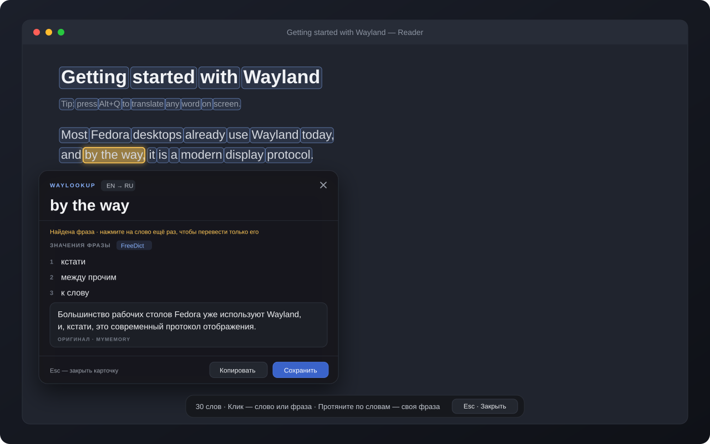

<div align="center">

# 🔎 WayLookup

**Перевод слов и фраз прямо с экрана в Wayland — по одному нажатию.**

Нажмите бинд, кликните по слову — и получите значения из словаря, перевод предложения и оригинал.
OCR и словари работают локально, на вашем компьютере.

[](CHANGELOG.md)
[](https://github.com/DarolCup/WayLookup/actions/workflows/check.yml)


[](LICENSE)

[Установка](#-быстрая-установка-fedora) · [Как пользоваться](#-как-пользоваться) · [Сборка из исходников](#-сборка-из-исходников) · [Что используется](#-что-используется) · [История изменений](CHANGELOG.md) · [English](docs/README.en.md)



<sub>Иллюстрация интерфейса версии 0.2: подсвеченные слова, найденная фраза и карточка перевода.</sub>

</div>

---

## ✨ Возможности

- **Одно нажатие** — бинд снимает экран, и через мгновение все слова подсвечены рамками.
- **Клик по слову** — значения из офлайн-словаря с названием источника, перевод всего предложения и оригинал с подсветкой.
- **Фразы целиком** — клик по слову сам находит устойчивое выражение рядом (например, *by the way*). Протяните мышью по словам, чтобы выбрать свою фразу.
- **Умная карточка** — появляется рядом со словом и не закрывает текст: у правого края — слева, у верхнего — снизу, у нижнего — сверху.
- **Esc по шагам** — первое нажатие закрывает карточку, второе — весь оверлей.
- **Прозрачный оверлей** — рамки поверх живого экрана, клики мимо рамок проходят в приложение.
- **Разные шрифты и размеры** — OCR работает в несколько проходов и находит мелкие подписи.
- **Словарь для запоминания** — кнопка «Сохранить» добавляет слово в `words.txt`.
- **Свои источники** — словари StarDict и JSON, MyMemory, Google Cloud, LibreTranslate или локальный ИИ через Ollama.

## 🖥 Поддерживаемые системы

| Система | Окружение | Установка |
| --- | --- | --- |
| Fedora | KDE Plasma (Wayland) | Скрипт-установщик |
| Fedora | GNOME (Wayland) | Скрипт-установщик |
| Arch Linux | Hyprland | Пакет `pacman` из Releases или исходники |

> [!NOTE]
> Нужна сессия **Wayland**. X11 не поддерживается.

---

## 🚀 Быстрая установка (Fedora)

Самый простой путь — одна команда. Откройте терминал и вставьте:

```bash
curl -fsSL https://raw.githubusercontent.com/DarolCup/WayLookup/main/install-fedora.sh | bash
```

Скрипт сам:

1. поставит нужные пакеты через `sudo dnf` (попросит пароль);
2. скачает офлайн-словари **EN → RU**, **RU → EN** и **DE → RU**;
3. запустит WayLookup и включит автозапуск при входе;
4. добавит **WayLookup** в меню приложений.

**Осталось назначить клавишу:**

- **GNOME** — по умолчанию уже работает **Alt+Q**. При первом захвате выберите экран, оставьте включённым «Запомнить этот выбор» и нажмите «Поделиться».
- **KDE Plasma** — откройте **Системные настройки → Комбинации клавиш**, добавьте команду `~/.local/bin/waylookup capture` (полный путь: `/home/ВАШ_ПОЛЬЗОВАТЕЛЬ/.local/bin/waylookup capture`) и назначьте сочетание, например **Alt+Q**.

Проверить, что всё на месте:

```bash
~/.local/bin/waylookup doctor
```

<details>
<summary><b>Параметры установщика</b></summary>

Параметры передаются так: `curl -fsSL …/install-fedora.sh | bash -s -- ПАРАМЕТРЫ`

| Параметр | Что делает |
| --- | --- |
| `--desktop plasma` / `--desktop gnome` | Указать окружение вручную, если установка идёт вне графической сессии |
| `--ref ВЕТКА` | Установить версию из другой ветки, например для тестирования |
| `--deps-only` | Поставить только системные зависимости (для сборки из исходников) |
| `--uninstall` | Удалить программу, ярлык, автозапуск и сочетание в GNOME |
| `--uninstall --purge` | То же, плюс удалить настройки, словари и историю |

</details>

## 📦 Arch Linux + Hyprland

1. Откройте [Releases](https://github.com/DarolCup/WayLookup/releases), выберите последний релиз и скачайте из **Assets** файл `waylookup-*-any.pkg.tar.zst` и `SHA256SUMS`.
2. В папке с файлами выполните:

```bash
sha256sum --ignore-missing --check SHA256SUMS && sudo pacman -U ./waylookup-*-any.pkg.tar.zst
waylookup doctor
waylookup daemon
```

`pacman` сам поставит зависимости. Запускайте внутри сессии Hyprland и без `sudo`. Бинд **Alt+Q** WayLookup регистрирует сам через `hyprctl` и не трогает ваши конфиги. Для фонового запуска см. «Автозапуск в Hyprland» в разделе [Настройка](#-настройка).

> [!TIP]
> В панели должен быть включён tray (например, модуль `tray` в Waybar) — через него доступны перевод экрана, настройки и выход.

---

## 🎯 Как пользоваться

| Действие | Результат |
| --- | --- |
| **Бинд** (Alt+Q) | Захват экрана, все слова подсвечиваются рамками |
| **Клик по слову** | Карточка со значениями и переводом предложения |
| **Клик по слову фразы** | Найденная фраза переводится целиком; повторный клик — только это слово |
| **Протянуть по словам** | Перевести свою фразу |
| **Esc** | Закрыть карточку; ещё раз — закрыть оверлей |
| **Бинд ещё раз** | Закрыть оверлей |
| **F2** | Переключиться на стоп-кадр, если текст на экране двигается |
| **Копировать / Сохранить** | Скопировать результат или добавить его в `words.txt` |

Координаты слов берутся из кадра в момент нажатия. Если текст сдвинулся, нажмите бинд ещё раз.

---

## 🛠 Сборка из исходников

### Fedora

```bash
git clone https://github.com/DarolCup/WayLookup.git
cd WayLookup
./install-fedora.sh --deps-only
python3 -m venv --system-site-packages .venv
.venv/bin/python -m pip install build
.venv/bin/python -m build
.venv/bin/python -m pip install dist/waylookup-*.whl
.venv/bin/waylookup doctor
.venv/bin/waylookup daemon
```

`--system-site-packages` обязателен: обычная `.venv` не видит системный PyGObject.

### Arch Linux

```bash
sudo pacman -S --needed git python python-gobject python-cairo gtk3 gtk-layer-shell \
  grim tesseract tesseract-data-eng libayatana-appindicator
git clone https://github.com/DarolCup/WayLookup.git
cd WayLookup
python -m waylookup doctor
python -m waylookup daemon
```

`pip install` здесь не нужен — используются системные библиотеки. Из другой папки запускайте по абсолютному пути: `/путь/к/WayLookup/scripts/waylookup daemon`.

### Сборка Arch-пакета

Нужны `base-devel`, `python-build`, `python-installer`, `python-setuptools`, `python-wheel`.

```bash
git archive --format=tar.gz --prefix=waylookup-0.2.0/ \
  -o packaging/waylookup-0.2.0.tar.gz HEAD
cd packaging
makepkg -si
```

PKGBUILD рассчитан на локальный архив. Пакет ставит команду `waylookup`, ярлык, user unit и демонстрационный словарь.

---

## 🧰 Что используется

| Компонент | Зачем |
| --- | --- |
| **Python 3.11+** | Весь код приложения |
| **GTK 3 + PyGObject, Cairo** | Оверлей, рамки, карточка и анимации |
| **gtk-layer-shell** | Прозрачный оверлей поверх экрана (Plasma, Hyprland) |
| **Tesseract OCR** | Распознавание текста на снимке |
| **Pillow** | Подготовка кадра и локальный контраст для мелкого текста |
| **Spectacle** (Plasma) · **xdg-desktop-portal + PipeWire/GStreamer** (GNOME) · **grim** (Hyprland) | Снимок экрана |
| **SQLite** | Индекс офлайн-словарей |
| **StarDict / JSON, FreeDict + WikDict** | Словари по умолчанию |
| **MyMemory** (по умолчанию), Google Cloud, LibreTranslate, Ollama | Перевод предложений и, по желанию, слов |
| **D-Bus (GApplication), systemd user unit** | Один фоновый демон, команды и автозапуск |
| **AppIndicator** | Значок в трее |

---

## 🔧 Настройка

Окно настроек: `waylookup settings` или через трей. Изменения применяются сразу.

<details>
<summary><b>Команды</b></summary>

```bash
waylookup capture        # захват экрана
waylookup settings       # окно настроек
waylookup doctor         # проверка зависимостей
waylookup quit           # завершить демон
waylookup config --init  # создать config.json с настройками по умолчанию
waylookup --help
```

При запуске из исходников вместо `waylookup` используйте `python -m waylookup`.

</details>

<details>
<summary><b>config.json</b></summary>

Файл: `~/.config/waylookup/config.json`. Можно указать только нужные поля, остальные получат значения по умолчанию. После ручного изменения перезапустите демон.

```json
{
  "hotkey": "ALT+Q",
  "source": "en",
  "target": "ru",
  "ocr_languages": "eng",
  "ocr_psm": 3,
  "min_confidence": 35.0,
  "word_mode": "dictionary",
  "word_provider": "same",
  "sentence_provider": "mymemory",
  "dictionary_fallback": false,
  "register_hotkey": true
}
```

- Для OCR на двух языках задайте `eng+rus` (в Arch нужен `tesseract-data-rus`).
- `ocr_psm`: **3** — автоматически, **11** — игры и разрозненный текст, **6** — один блок субтитров.

</details>

<details>
<summary><b>Словари</b></summary>

Поддержаны **StarDict** (`.ifo` + `.idx` + `.dict`/`.dict.dz`) и простые JSON-словари. Установщик Fedora сам ставит FreeDict + WikDict, при ручной сборке — `waylookup dictionary install-defaults`.

```bash
waylookup dictionary import /путь/к/словарю.ifo --source en --target ru
waylookup dictionary list
```

Свой JSON-словарь:

```json
{
  "sword": ["меч", "клинок"],
  "river": ["река", "поток"]
}
```

Словари можно скачать на [freedict.org](https://freedict.org/downloads/).

</details>

<details>
<summary><b>Переводчики и ИИ</b></summary>

| Провайдер | Подключение |
| --- | --- |
| MyMemory | По умолчанию, без ключа (до 500 байт за запрос) |
| Google Cloud Translation | `WAYLOOKUP_GOOGLE_API_KEY=ключ` в `~/.config/waylookup/providers.env` |
| LibreTranslate | Адрес сервера, по умолчанию `http://127.0.0.1:5000`; ключ — `WAYLOOKUP_LIBRETRANSLATE_KEY` |
| Ollama | Адрес и модель, по умолчанию `http://127.0.0.1:11434` и `qwen3:8b` |
| Отключить | Полностью офлайн, только словарь |

После изменения `providers.env` выполните `chmod 600 ~/.config/waylookup/providers.env` и `systemctl --user restart waylookup.service`.

</details>

<details>
<summary><b>Автозапуск в Hyprland</b></summary>

Выберите **один** вариант.

Lua-конфигурация:

```lua
hl.on("hyprland.start", function()
    hl.exec_cmd("waylookup daemon")
end)
```

Hyprlang:

```ini
exec-once = waylookup daemon
```

Или user unit (для сессий с `graphical-session.target`, например UWSM):

```bash
systemctl --user enable --now waylookup.service
```

</details>

## 📁 Где хранятся файлы

| Что | Путь |
| --- | --- |
| Программа | `~/.local/bin/waylookup`, `~/.local/lib/waylookup/` |
| Настройки | `~/.config/waylookup/` |
| Словари и история | `~/.local/share/waylookup/` |
| Сохранённые слова | `~/.local/share/waylookup/words.txt` |
| Сервис | `~/.config/systemd/user/waylookup.service` |

## 🔄 Обновление и удаление

| Способ установки | Обновление | Удаление |
| --- | --- | --- |
| Fedora (скрипт) | Повторите команду [быстрой установки](#-быстрая-установка-fedora) | `curl -fsSL https://raw.githubusercontent.com/DarolCup/WayLookup/main/install-fedora.sh \| bash -s -- --uninstall` |
| Arch (пакет) | `waylookup quit`, затем `sudo pacman -U ./новый-пакет.pkg.tar.zst` | `sudo pacman -R waylookup` |
| Исходники | `git pull --ff-only` и перезапуск | Удалите папку проекта |

Настройки, словари и `words.txt` при удалении сохраняются (в Fedora их стирает `--purge`).

## 🩺 Если что-то не так

| Проблема | Что сделать |
| --- | --- |
| Ничего не происходит по бинду | `waylookup doctor`, затем `journalctl --user -u waylookup -f` |
| Бинд занят | Выберите другое сочетание в настройках (`SUPER+SHIFT+T`, `CTRL+F8`…) |
| Рамки не совпадают с текстом | Текст сдвинулся — нажмите бинд ещё раз или **F2** для стоп-кадра |
| GNOME каждый раз спрашивает экран | Включите «Запомнить этот выбор»; сменить экран — «Выбрать монитор…» в настройках |
| Мелкий текст не находится | Поставьте `ocr_psm` = 11 и Pillow |

Подробнее об устройстве и ограничениях — в [docs/architecture.md](docs/architecture.md).

## 🧪 Разработка

```bash
python -m unittest discover -s tests -v
uvx ruff check .
python -m build
```

Тесты не требуют дисплея и сети. GitHub Actions проверяет их на Python 3.11 и 3.14. Живая проверка GUI: `python tests/live_smoke.py` (временно закрывает монитор оверлеем). Правила участия — в [CONTRIBUTING.md](CONTRIBUTING.md).

## 📄 Лицензия

[MIT](LICENSE).

<div align="center">
<sub>Код написан с помощью ИИ-агентов.</sub>
</div>
