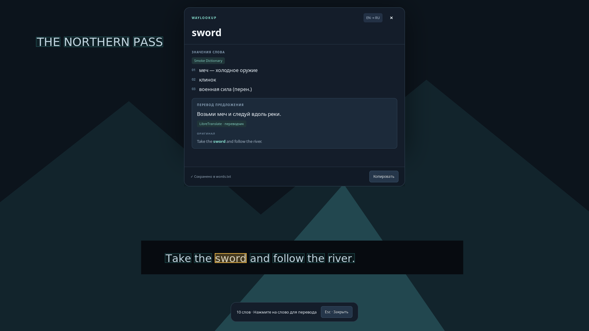

# WayLookup

**Перевод слова и предложения по клику в Wayland.**

[English](docs/README.en.md) · [Fedora / Plasma и GNOME](#fedora-kde-plasma-и-gnome) · [Arch / Hyprland](#установка-готового-пакета-arch) · [История изменений](CHANGELOG.md)

WayLookup работает в **Arch Linux с Hyprland** и **Fedora с KDE Plasma или GNOME** в сессии Wayland. Вызовите захват экрана и выберите слово на застывшем снимке. Карточка покажет значения по источникам, перевод предложения и оригинал с подсветкой выбранного слова. **Esc** закрывает оверлей.

Версия **0.1.1** с переработанной карточкой перевода: длинные статьи раскрываются отдельно, повторяющиеся значения объединяются, ошибки не смешиваются с результатом. Неудачный запрос можно повторить кнопкой «Повторить». Проверена в Hyprland 0.57.0 на одном мониторе 1920×1080; код также поддерживает старые бинды Hyprlang, но на старом композиторе эта ветка ещё не проверена. Это самостоятельная реализация, не связанная с Lookupper.



Скриншот настоящего оверлея на синтетической игровой сцене: три значения из тестового словаря и ответ локального HTTP-сервера проверки. Это демонстрация интерфейса, не оценка качества машинного перевода.

## Fedora KDE Plasma и GNOME

### Быстрая установка и обновление

Выполните в терминале в сессии Wayland. Эта же команда обновляет уже установленный WayLookup.

```bash
curl -fsSL https://raw.githubusercontent.com/DarolCup/WayLookup/main/install-fedora.sh | bash
```

Скрипт ставит системные зависимости через `sudo dnf`, загружает офлайн-словари **EN → RU**, **RU → EN** и **DE → RU**, запускает сервис и включает его при входе. **WayLookup** появится в меню приложений. Команда `~/.local/bin/waylookup doctor` покажет состояние зависимостей.

- **GNOME.** Нажмите **Alt+Q**. При первом захвате выберите экран, оставьте включённым **«Запомнить этот выбор»** и нажмите **«Поделиться»**. Следующие захваты используют этот экран, пока портал сохраняет разрешение. Для смены экрана нажмите **«Выбрать монитор…»** в настройках. Если Alt+Q занят, укажите другое сочетание там же.
- **KDE Plasma.** В **Системные настройки → Комбинации клавиш** назначьте команду `/home/ВАШ_ПОЛЬЗОВАТЕЛЬ/.local/bin/waylookup capture` на нужное сочетание.

### Сборка из исходников

```bash
git clone https://github.com/DarolCup/WayLookup.git
cd WayLookup
./install-fedora.sh --deps-only
python3 -m venv --system-site-packages .venv
.venv/bin/python -m pip install build
.venv/bin/python -m build
.venv/bin/python -m pip install dist/waylookup-*.whl
.venv/bin/waylookup doctor
.venv/bin/waylookup daemon
```

Для разработки можно запустить `./scripts/waylookup daemon` прямо из репозитория после установки зависимостей. При установке вне графической сессии передайте `--desktop plasma` или `--desktop gnome`. Сборка в `.venv` запускается вручную.

### Где хранятся файлы

| Что | Путь по умолчанию |
| --- | --- |
| Команда и установленные версии | `~/.local/bin/waylookup`, `~/.local/lib/waylookup/` |
| Настройки и разрешение на захват | `~/.config/waylookup/` |
| Словари и история | `~/.local/share/waylookup/` |
| Сервис и ярлык | `~/.config/systemd/user/waylookup.service`, `~/.local/share/applications/io.github.waylookup.WayLookup.desktop` |

У каждого пользователя свои настройки и словари. Пути конфигурации и данных учитывают `XDG_CONFIG_HOME` и `XDG_DATA_HOME`. Состояние сервиса можно посмотреть через `systemctl --user status waylookup.service`, журнал через `journalctl --user -u waylookup.service`.

### Удаление

Удалить программу, ярлык, автозапуск и сочетание WayLookup в GNOME:

```bash
curl -fsSL https://raw.githubusercontent.com/DarolCup/WayLookup/main/install-fedora.sh |
  bash -s -- --uninstall
```

Настройки, словари и история сохраняются. Чтобы удалить и их, добавьте `--purge` после `--uninstall`. Для сборки из исходников сначала выполните `.venv/bin/waylookup quit`. В GNOME также выполните `.venv/bin/waylookup shortcut --remove`. Затем удалите пакет командой `.venv/bin/python -m pip uninstall waylookup`.

## Установка готового пакета Arch

На странице [Releases](https://github.com/DarolCup/WayLookup/releases) выберите релиз **v0.1.1**, раскройте **Assets** и скачайте:

- `waylookup-0.1.1-1-any.pkg.tar.zst` — установочный пакет.
- `SHA256SUMS` — контрольные суммы.

В папке с загруженными файлами:

```bash
sha256sum --ignore-missing --check SHA256SUMS && sudo pacman -U ./waylookup-0.1.1-1-any.pkg.tar.zst
waylookup doctor
waylookup daemon
```

`pacman` установит необходимые системные зависимости. После установки команда `waylookup` доступна из любой папки; приложение также появится в меню программ. Первый запуск — внутри сессии Hyprland, без `sudo`. Для фонового запуска после входа см. [автозапуск](#автозапуск).

Проверка SHA256 подтверждает целостность файла относительно опубликованного списка, но не является криптографической подписью автора. Пакет не публиковался в официальных репозиториях Arch или AUR.

Если готового релиза ещё нет, используйте запуск из исходников ниже.

## Быстрый запуск из исходников

В сессии Hyprland установите системные зависимости:

```bash
sudo pacman -S --needed git python python-gobject python-cairo gtk3 gtk-layer-shell \
  grim tesseract tesseract-data-eng libayatana-appindicator
```

Скачайте проект через Git и перейдите в его папку. Команда `python -m waylookup` работает из папки проекта; без установки из домашнего каталога она не найдёт модуль:

```bash
git clone https://github.com/DarolCup/WayLookup.git
cd WayLookup
python -m waylookup doctor
python -m waylookup daemon
```

Без Git можно нажать **Code → Download ZIP** на странице репозитория, распаковать архив и выполнить те же команды из полученной папки. В отличие от готового пакета, исходники не устанавливают системную команду.

Из любой другой папки используйте абсолютный путь к `scripts/waylookup`, например `/путь/к/WayLookup/scripts/waylookup daemon`. Из корня проекта также работает `./scripts/waylookup daemon`. Вторая команда работает в переднем плане терминала, а приложение живёт в tray. Для фоновой работы используйте автозапуск ниже. Python-библиотеки берутся из системного Arch Python; `pip install` для запуска из исходников не нужен. Обычная изолированная `.venv` не видит системный PyGObject; если она нужна, создайте её с `python -m venv --system-site-packages .venv`.

По умолчанию направление **en → ru**, OCR **eng**. Значение слова ищется в локальном словаре, а перевод предложения запрашивается у MyMemory. В настройках можно отключить онлайн-перевод предложения или выбрать другой сервис. Снимок экрана и OCR остаются локальными.

1. В панели должен быть включён tray (например, модуль `tray` в Waybar). Через него доступны перевод экрана, настройки, файл слов и выход.
2. Нажмите **Alt+Q**. Программа снимет **текущий сфокусированный монитор** и откроет оверлей с уже выделенными словами. На больших кадрах с подходящим разделителем OCR может обработать две области параллельно.
3. Нажмите на слово. Сверху появятся значения с названием источника, исходное предложение и его перевод. Можно выбрать следующее слово, выделить текст перевода или скопировать результат.
4. Нажмите **Esc**, кнопку закрытия или снова бинд, чтобы убрать оверлей.

Если бинд занят, WayLookup сохранит существующее действие и покажет уведомление. Откройте `python -m waylookup settings` и выберите другую комбинацию. В настройках бинд меняется без перезапуска; примеры: `ALT+Q`, `SUPER+SHIFT+T`, `CTRL+F8`.

## Словари и несколько значений

Поддержаны **StarDict** (`.ifo` + `.idx`/`.idx.gz` + `.dict`/`.dict.dz`, опционально `.syn`) и простые JSON-словари. Статьи индексируются в локальную SQLite-базу. Поиск учитывает регистр, Unicode и типографский апостроф. Значения каждого подключённого словаря показываются с его названием. StarDict HTML/XML преобразуется в текст, бинарные медиа не отображаются; нестандартные бинарные `sametypesequence` отклоняются.

Для полноценного словаря скачайте нужную пару в формате **StarDict**, например **English–Russian** на [официальной странице FreeDict](https://freedict.org/downloads/), распакуйте архив и укажите `.ifo`:

```bash
python -m waylookup dictionary import /путь/к/словарю.ifo --source en --target ru
python -m waylookup dictionary list
```

Установщик Fedora автоматически импортирует три проверенных архива FreeDict + WikDict. При ручной сборке установите их командой `waylookup dictionary install-defaults`. Лицензии и атрибуция сохраняются в `~/.local/share/waylookup/dictionary-licenses/`. [FreeDict](https://freedict.org/downloads/)

Можно нажать **«Импорт словаря…»** в настройках. При этом используются языки, указанные в форме. Рядом с `.ifo` должны оставаться файлы статей и индекса. Импорт работает в фоне, повторный импорт того же названия заменяет соответствующий словарь в выбранном направлении. Ошибка импорта сохраняет прежнюю версию.

Для проверки есть небольшой **демонстрационный**, написанный вручную словарь из 11 слов; это не полноценная база:

```bash
python -m waylookup dictionary import examples/en-ru.json --source en --target ru --name Demo
```

Свой JSON можно оформить так:

```json
{
  "sword": ["меч", "клинок"],
  "river": ["река", "поток"]
}
```

При поиске сначала проверяется точная форма, затем несколько распространённых английских окончаний. Для встроенного набора значения с совпадениями между пояснением и контекстом поднимаются выше. При необходимости в настройках можно включить машинный перевод для слов, которых нет в словаре.

## Переводчик и ИИ

Перевод слова и предложения настраиваются отдельно. Для слова можно выбрать **офлайн-словарь**, **переводчик** или **ИИ / Ollama**. В режиме «Переводчик» выберите источник слова отдельно или используйте источник предложения.

| Провайдер | Подключение | Особенности |
| --- | --- | --- |
| MyMemory | Работает по умолчанию, без ключа | Интернет, квоты сервиса, максимум 500 UTF-8 байт за запрос; результат не является словарной статьёй |
| Google Cloud Translation | Нужен ключ проекта с включённым Cloud Translation API | Онлайн-перевод слов и предложений |
| LibreTranslate | Укажите адрес своего сервера, по умолчанию `http://127.0.0.1:5000` | Перевод предложений и слов; при необходимости ключ через `WAYLOOKUP_LIBRETRANSLATE_KEY` |
| Ollama | Укажите адрес и установленную модель, по умолчанию `http://127.0.0.1:11434` и `qwen3:8b` | Локальный ИИ, отдельный запрос значения слова с контекстом и нескольких вариантов; модель необходимо установить самостоятельно |
| Отключить | Выберите в настройках | Полностью офлайн со словарём, если отключён и fallback |

Для Google Cloud сохраните строку `WAYLOOKUP_GOOGLE_API_KEY=ваш_ключ` в `~/.config/waylookup/providers.env`, ограничьте доступ через `chmod 600 ~/.config/waylookup/providers.env` и перезапустите сервис командой `systemctl --user restart waylookup.service`. При запуске из терминала задайте эту переменную в окружении. Затем выберите **Google Cloud** в настройках WayLookup. [Документация Google Cloud Translation](https://docs.cloud.google.com/translate/docs/reference/rest/v2/translate)

Для Ollama нужны запущенный сервис и установленная модель с именем из настроек. Чтобы Ollama обрабатывала и слово, и предложение, выберите её в обоих полях. При недоступном сервере карточка покажет ошибку Ollama для соответствующего поля. Для первого запуска большой модели можно увеличить таймаут до 180 секунд.

Ссылки на API: [MyMemory](https://mymemory.translated.net/doc/spec.php), [LibreTranslate](https://docs.libretranslate.com/api/operations/translate/), [Ollama](https://github.com/ollama/ollama/blob/main/docs/api.md). Ответы переводчиков кэшируются в памяти (до 256 запросов). Сеть и OCR выполняются вне GTK-потока: можно сразу закрыть оверлей. Поздние ответы предыдущего выбора не заменяют текущий результат.

## Файл для запоминания

Нажмите **«Сохранить»** в карточке, чтобы добавить результат в файл:

```text
~/.local/share/waylookup/words.txt
```

В файле UTF-8 записи разделены линиями и пустыми строками. В каждой записи есть дата, слово и отдельные блоки для значений, оригинала и перевода предложения. Повторное сохранение того же результата не создаёт дубликат. При наличии только словарных значений или только перевода предложения можно сохранить доступную часть.

Путь меняется в настройках. Кнопка tray «Открыть words.txt» открывает выбранный файл в системном редакторе.

## Настройки и команды

```bash
python -m waylookup settings
python -m waylookup capture
python -m waylookup quit
python -m waylookup config --init
python -m waylookup --help
```

Повторные команды отправляются уже запущенному демону через пользовательскую D-Bus-сессию (GApplication). Если демон не запущен, `capture` или `settings` запускают его. `quit` завершает процесс и удаляет принадлежащий ему временный бинд.

Конфигурация: `~/.config/waylookup/config.json`. `config --init` создаёт её с настройками по умолчанию, если файла ещё нет. Основные параметры:

```json
{
  "hotkey": "ALT+Q",
  "source": "en",
  "target": "ru",
  "ocr_languages": "eng",
  "ocr_psm": 3,
  "min_confidence": 35.0,
  "word_mode": "dictionary",
  "word_provider": "same",
  "sentence_provider": "mymemory",
  "dictionary_fallback": false,
  "register_hotkey": true
}
```

Это допустимый частичный конфиг: остальные поля получают значения по умолчанию. После ручного изменения JSON перезапустите демон. GUI применяет настройки сразу. Переменные `XDG_CONFIG_HOME` и `XDG_DATA_HOME` поддерживаются.

Для русского OCR установите `tesseract-data-rus` и задайте `eng+rus`. Если отдельные подписи пропускаются, попробуйте **PSM 11** (разрозненный текст), для субтитров — **PSM 6** (единый блок). PSM 3 лучше сохраняет структуру обычных абзацев. Неизвестные названия языков Tesseract выводятся в диагностике и оверлее.

## Автозапуск

После установки Arch-пакета используйте **один** вариант.

Для Hyprland с конфигурацией Lua:

```lua
hl.on("hyprland.start", function()
    hl.exec_cmd("waylookup daemon")
end)
```

Для старой конфигурации Hyprlang:

```ini
exec-once = waylookup daemon
```

Для запуска из исходников замените команду на **абсолютный путь** к `scripts/waylookup daemon`. Приложение само добавляет временный бинд через `hyprctl`, поддерживает Lua API новых версий и Hyprlang старых, восстанавливает бинд по событию `configreloaded` и не редактирует конфиги Hyprland. Поведение API описано в [документации биндов](https://wiki.hypr.land/configuring/core/binds/) и [IPC](https://wiki.hypr.land/ipc/).

Альтернатива для сессий с корректно настроенным `graphical-session.target` (например, UWSM) — установленный user unit:

```bash
systemctl --user enable --now waylookup.service
```

В окружении user manager должны быть `WAYLAND_DISPLAY`, `HYPRLAND_INSTANCE_SIGNATURE` и `XDG_RUNTIME_DIR`. При обычном запуске Hyprland удобнее его собственный автозапуск. Не включайте оба варианта одновременно.

При желании отключите «Регистрировать бинд» и назначьте команду `waylookup capture` вручную в Hyprland. Это также выход, если используемая версия композитора несовместима с автоматической регистрацией.

## Сборка Arch-пакета

Установите `base-devel`, `python-build`, `python-installer`, `python-setuptools`, `python-wheel`. Из закоммиченного дерева репозитория:

```bash
git archive --format=tar.gz --prefix=waylookup-0.1.1/ \
  -o packaging/waylookup-0.1.1.tar.gz HEAD
cd packaging
makepkg -si
```

`PKGBUILD` рассчитан на локальный архив; `SKIP` относится к созданному вами архиву, а не к удалённой загрузке. Для публикации PKGBUILD в AUR необходимо отдельно подготовить release URL и SHA256; эта версия PKGBUILD предназначена для локальной сборки. Пакет устанавливает команду `waylookup`, desktop entry, user unit и демонстрационный словарь в `/usr/share/waylookup/examples/`.

Обычный Python wheel также собирается `python -m build`. Он содержит Python-код и CSS; системные GTK-зависимости, desktop entry и systemd unit устанавливаются Arch-пакетом. На Arch не устанавливайте wheel через `sudo pip` поверх системного Python.

## Проверки и разработка

```bash
python -m unittest discover -s tests -v
uvx ruff check .
python -m build
```

Тесты ядра не требуют дисплея, сети или PyGObject. GitHub Actions проверяет их на Python 3.11 и 3.14, запускает линтер и сборку.

Отдельная проверка реального GUI **временно закрывает текущий монитор оверлеем** и затем сама его убирает:

```bash
python tests/live_smoke.py --screenshot /tmp/waylookup-preview.png
```

Она использует временные XDG-папки, синтетическую сцену, реальный Tesseract, локальный HTTP-сервер и проверяет клик, несколько значений, предложение, файл слов, Esc, открытие настроек, размеры карточки с длинным текстом и раскрытой статьёй, переключение загрузки/ошибок и отбрасывание устаревших ответов. Внешним переводчикам ничего не отправляется. Настройки пользователя не меняются, тестовые файлы очищаются. Снимок реального рабочего стола проверяется только в памяти; на диск сохраняется синтетическая сцена с оверлеем.

Архитектура и известные ограничения — в [docs/architecture.md](docs/architecture.md). Лицензия кода — MIT. Репозиторий можно публиковать на GitHub: личных словарей, ключей, истории и настроек в нём нет.

## Обновление и удаление

В Fedora для обновления повторите [команду быстрой установки](#быстрая-установка-и-обновление). Установщик перезапустит сервис с новой версией.

Если установлен Arch-пакет, остановите демон (`waylookup quit`), скачайте новый пакет из Releases и установите его через `sudo pacman -U ./имя-пакета.pkg.tar.zst`, затем запустите `waylookup daemon`.

Для исходников остановите приложение, выполните `git pull --ff-only` из папки проекта и запустите его снова. При переходе с исходников на пакет сначала остановите старый демон: пользовательская D-Bus-сессия допускает только один экземпляр.

Удаление установленного пакета: `sudo pacman -R waylookup`. Конфигурация, словари и `words.txt` в домашнем каталоге сохранятся. Если включён user unit, предварительно выполните `systemctl --user disable --now waylookup.service`; для автозапуска Hyprland удалите добавленную вами строку.

## Сообщения об ошибках и участие

Инструкции для разработки и оформления багов — в [CONTRIBUTING.md](CONTRIBUTING.md). Перед отправкой проверьте диагностику `waylookup doctor`. Не публикуйте API-ключи, личную историю слов и скриншоты приватных окон.

Код написан ИИ (OpenAI Codex).
