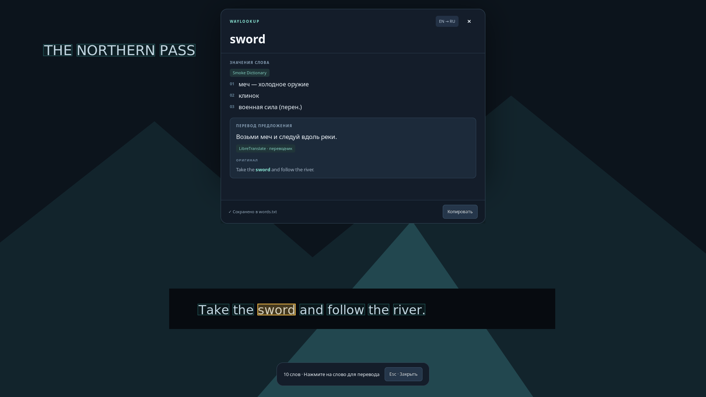

# WayLookup

[Русский README](../README.md)

Click a word on a frozen screenshot to translate the word and its sentence. WayLookup runs on Wayland with Hyprland on Arch Linux, or KDE Plasma and GNOME on Fedora. The current interface is in Russian and the default translation direction is English → Russian.



Start a capture, click a highlighted word, read its dictionary meanings and sentence translation at the top centre of the screen, then press **Esc**. On Hyprland, the default shortcut is **Alt+Q**. A tray menu provides capture, settings, vocabulary and exit on desktops with a system tray.

This is an early independent project, not affiliated with Lookupper. The screenshot uses a synthetic scene and a local test server; it demonstrates the interface rather than translation quality.

## Fedora KDE Plasma and GNOME

Run the installer as your normal user in a Wayland session. It detects the desktop, installs system dependencies using `sudo dnf`, and adds `waylookup` to `~/.local/bin`.

**With curl**

```bash
installer=$(mktemp)
curl -fsSL https://raw.githubusercontent.com/DarolCup/WayLookup/codex/fedora-desktops/install-fedora.sh -o "$installer" &&
  bash "$installer" --ref codex/fedora-desktops
rm -f "$installer"
```

**With Git**

```bash
git clone --branch codex/fedora-desktops https://github.com/DarolCup/WayLookup.git
cd WayLookup
./install-fedora.sh
```

```bash
~/.local/bin/waylookup doctor
~/.local/bin/waylookup settings
```

Bind `/home/YOUR_USER/.local/bin/waylookup capture` to a shortcut such as **Alt+Q**. On **Plasma**, open **System Settings → Shortcuts**. On **GNOME**, open **Keyboard → View and Customize Shortcuts → Custom Shortcuts**. GNOME prompts you to choose and share a monitor at capture time.

To update, rerun the installer with the latest sources, run `~/.local/bin/waylookup quit` and invoke capture again. Outside a graphical session, use `--desktop plasma` or `--desktop gnome` to select the dependencies.

## Install on Arch Linux

Download `waylookup-0.1.1-1-any.pkg.tar.zst` and `SHA256SUMS` from [Releases](https://github.com/DarolCup/WayLookup/releases). In the download directory:

```bash
sha256sum --ignore-missing --check SHA256SUMS && sudo pacman -U ./waylookup-0.1.1-1-any.pkg.tar.zst
waylookup doctor
waylookup daemon
```

`pacman` installs the system dependencies. Run the application as your normal user inside Hyprland. Enable the tray module in your panel. SHA256 checks detect corruption relative to the published list; they are not an author signature. This package is not in the official Arch repositories or AUR.

## Run from source

```bash
sudo pacman -S --needed git python python-gobject python-cairo gtk3 gtk-layer-shell \
  grim tesseract tesseract-data-eng libayatana-appindicator
git clone https://github.com/DarolCup/WayLookup.git
cd WayLookup
python -m waylookup doctor
python -m waylookup daemon
```

You can also use **Code → Download ZIP**, unpack it and run the last two commands inside the extracted directory. `python -m waylookup` requires the project directory unless the package has been installed. To run a checkout from any directory, use the absolute path to `scripts/waylookup`.

The system Python can use Arch's PyGObject packages directly. If using a virtual environment, create it with `--system-site-packages`.

## Translation and dictionaries

- Local Tesseract OCR: screenshots are never sent to a translation service.
- StarDict (`.ifo`, `.idx`/`.idx.gz`, `.dict`/`.dict.dz`, optional `.syn`) and JSON dictionaries, indexed locally in SQLite.
- MyMemory is enabled by default and sends the selected word and sentence over the internet. Service quotas and a 500-byte request limit apply.
- LibreTranslate supports a self-hosted server; its optional key is read from `WAYLOOKUP_LIBRETRANSLATE_KEY`.
- Ollama supports local AI translation and contextual word meanings. Install and start Ollama, download your own model, and select its exact name in settings.

Dictionary data is not bundled. Download a suitable StarDict language pair from [FreeDict](https://freedict.org/downloads/), unpack it and import its `.ifo`:

```bash
python -m waylookup dictionary import /path/to/dictionary.ifo --source en --target ru
python -m waylookup dictionary list
```

For a small demo with eleven words:

```bash
python -m waylookup dictionary import examples/en-ru.json --source en --target ru --name Demo
```

Installed packages provide that demo under `/usr/share/waylookup/examples/en-ru.json`. Dictionary licenses are independent of the application license. Exact word forms and StarDict synonyms are supported; general lemmatisation is not yet implemented.

For fully offline use, select a local dictionary and disable sentence translation and dictionary fallback, or configure a local Ollama server.

## Configuration and vocabulary

```bash
waylookup settings
waylookup capture
waylookup quit
```

For a checkout, prefix commands with `python -m` while inside the project directory. Configuration is stored in `~/.config/waylookup/config.json`. Vocabulary goes to `~/.local/share/waylookup/words.txt`: word meanings, sources, context and sentence translation. The vocabulary path is configurable. Repeated identical contexts are deduplicated. XDG directory overrides are supported.

The GUI applies changes immediately. Restart after editing JSON manually. On Hyprland, the WayLookup settings accept shortcuts such as `ALT+Q`, `SUPER+SHIFT+T` and `CTRL+F8`, and report existing shortcut conflicts. On Fedora, the desktop controls the shortcut.

## Autostart

For a Lua Hyprland configuration:

```lua
hl.on("hyprland.start", function()
    hl.exec_cmd("waylookup daemon")
end)
```

For an older Hyprlang configuration:

```ini
exec-once = waylookup daemon
```

For source checkouts, use the absolute path to `scripts/waylookup daemon`. The application registers its own temporary shortcut and restores it after configuration reloads. It does not edit your Hyprland configuration.

A user service is included for sessions that correctly manage `graphical-session.target`, such as a configured UWSM session. Choose either the service or Hyprland autostart, not both. See the main README for environment requirements.

## Limits and validation

**The game can keep running while WayLookup shows the screenshot.** Only the captured monitor is covered. OCR accuracy depends on fonts, size, contrast and layout. Sentence boundaries are heuristic.

Tested with Hyprland 0.57.0 and in isolated Fedora 45 sessions with KDE Plasma 6.8.2 and GNOME 51.1. Mixed DPI, HDR and Gamescope still need live testing. Ollama is tested against response contracts. Startup of large models may require a longer timeout.

```bash
python -m unittest discover -s tests -v
uvx ruff check .
python -m build
```

An optional `python tests/live_smoke.py` runs the real overlay temporarily over the focused monitor using isolated configuration, synthetic content and a local HTTP fixture. It does not send text to external translators.

[Architecture](architecture.md) · [Contributing](../CONTRIBUTING.md) · [Changelog](../CHANGELOG.md) · [MIT license](../LICENSE)

The code was written by AI (OpenAI Codex).
